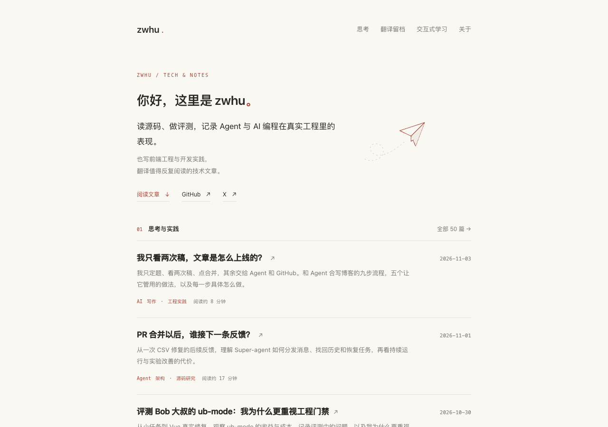

# zwhu · 个人技术博客

胡正伟的个人技术博客。读源码、做评测，记录 Agent 与 AI 编程在真实工程里的表现；也写前端工程与开发实践，翻译值得反复阅读的技术文章。

[阅读博客 →](https://zwhu.github.io/)

[](https://zwhu.github.io/)

原生 HTML、CSS 和 JavaScript，无构建依赖，由 GitHub Pages 发布 `docs/` 目录。

## 本地预览

```sh
python3 -m http.server 8765 --bind 127.0.0.1 --directory docs
```

打开 http://127.0.0.1:8765/ 。

维护时参考[工程说明](content/repository-guide.md)、[写作与发布流程](content/blog-publishing-workflow.md)和[验证流程](content/verification-guide.md)。
