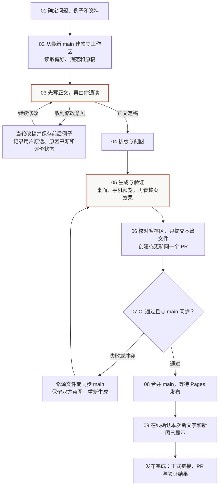

# 从本 session 整理的博客写作与发布流程

先把文章讲清楚，再排版配图。发布前的同篇改稿集中在一个 PR；公共样式与导航另开 PR。你重点看正文和整页效果，Agent 负责资料核对、同步文件、生成、检查和发布准备。

本轮补充的重点是：收到文字反馈时，当轮改稿并留下前后例子；把用户说过的原因、AI 的推测和改稿是否得到评价分别记录。后续写作先读精简的偏好文件，需要例子时再读相关记录。



正文有问题就继续改第 03 步；图和排版有问题就回第 04 步。看稿用于收集内容反馈，不是新增 GitHub 审批人数，也不用逐句等待确认。已获得的操作授权继续有效。

## 本 session 中哪些已经知道

| 情况 | 已有证据 | 应如何处理 |
| --- | --- | --- |
| 用户给出了自己的改写 | “需求是在群聊里提出的，而代码在 PR 里评审……” | 保存为用户自写样本，参见 [WF-20261102-03](./writing-feedback-log.md#wf-20261102-03)。 |
| 用户说不顺、读不懂或不需要 | 六处反馈均有原话 | 按要求修改；没有具体原因时写“未说明”。 |
| AI 解释为什么更顺 | “而”区分用途、“还是得”表达需要等解释由 AI 提出 | 作为待确认分析保留，不标为用户已认可原因。 |
| AI 改稿已提交或上线 | 有文件和 PR 记录 | 只证明改动已执行，不代表用户认可语气或归因。 |
| 删除同一段的要求重复出现 | 用户重复引用投入评估段落 | 在同一条记录追加，不当作多条独立偏好证据；同时核对当前稿与发布版本。 |
| 当前文件后来又有改动 | 引言中后来出现“继续追问”“系统需要能……” | 保留当前稿；没有对应原话时，不用 diff 推断修改者或用户意图。 |

## 写作反馈怎样进入下一次写作

1. 写作前读[个人写作偏好](./writing-preferences.md)，本次明确要求优先。
2. 收到纠正时，保存原句、用户原话、修改后版本和文档位置；具体方法见[反馈流程](./writing-feedback-guide.md)。
3. 原因来自用户就保留原话；用户没解释就写“未说明”；AI 的分析注明“待确认”。
4. 同一处反复修改，在原记录下追加后续版本，不丢掉之前的尝试。
5. 本篇的删改要求留在[修改记录](./writing-feedback-log.md)。用户明确确认长期范围后，再提炼到个人偏好。
6. 以后按任务读取相关例子，不必每次加载全部反馈历史。

目前可归纳出“先给具体场景”“写清分工与动作”“把实验边界展开说明”“图注与结尾减少无用信息”等候选方向，详细依据见修改记录。它们尚未全部得到用户确认，不作为全局禁用词或固定句式。

## 图示与发布的问题分别放哪里

| 本 session 的问题 | 后续做法 | 维护位置 |
| --- | --- | --- |
| “配图感觉很不和谐”“宽度整体都超出太多” | 沿用博客配色与字体，图在正文列内；桌面与手机实际预览。 | [视觉规范](../VISUAL_STYLE.md)、文章主题的 CSS 与图源。 |
| “这个箭头很奇葩” | 分开重叠线段与箭头连接点；验证方向、节点、文字和手机布局。 | 对应 SVG 生成脚本与图源。 |
| 图内注释没有意义 | 保存具体表达反馈；精简时保留理解所需的节点、调用名、数值与来源。 | 文字例子进修改记录，几何与排版要求进视觉规范。 |
| 同一工作区夹带别的改动 | 独立 worktree；明确文件范围；暂存具体文件后查看 `git diff --cached`。 | 本篇分支和 PR。 |
| 本地修好，PR 仍显示冲突 | 核对 PR 实际分支与提交，再把修正推回该分支。 | PR 的分支、CI 和冲突状态。 |
| 正文与阅读时长改在同一行 HTML | 按双方意图合并；生成区块从源配置重建；手写正文与元信息分行。 | HTML、对应元信息与生成脚本。 |
| 看见旧段落，但新版已删除 | 核对线上实际内容与发布提交；最终交付正式链接，避免只凭旧标签页判断。 | Pages 发布记录和在线预览。 |

## 信息放在哪里

| 信息 | 文件 |
| --- | --- |
| 任务入口与最少规则 | `AGENTS.md` |
| 通用中文润色方法与反馈触发条件 | `.agents/skills/doc-lint/SKILL.md` |
| 用户明确确认的长期写作偏好 | `content/writing-preferences.md` |
| 用户原话、前后例子、本篇要求、AI 候选解释与评价状态 | `content/writing-feedback-log.md` |
| 如何记录原因、处理后续版本和提炼偏好 | `content/writing-feedback-guide.md` |
| 视觉、图宽、字号与响应式约定 | `VISUAL_STYLE.md` |
| 各类内容、目录、SEO、分享图的源文件与生成方式 | `content/site-generation-guide.md` |
| 程序检查与实际预览的分工 | `content/verification-guide.md` |
| 当前文章 | 正文 HTML；已有 Markdown 对照稿的文章同步维护两份。 |

## 生成、验证与发布

修改对应源文件后，按需要运行专项生成器，再运行公共生成。当前工作区新增了统一验证入口：

```sh
python3 scripts/render-site.py
python3 scripts/verify.py
```

统一验证覆盖生成同步、链接、学习页样式、加载预算、图片、SEO 与测试，但不能确认文风符合用户习惯，或浏览器最终排版正确。文字按 doc-lint 逐段读，页面另做实际预览。

截至本轮整理，`verify.py`、反馈指南及其 CI 接入是工作区中的待提交改动；是否已进入正式 main，需要查看相应提交与 CI。不要把本地新增入口写成已在所有环境生效。

PR 创建或更新会触发检查；合并 main 后，主分支检查与 Pages 发布分别触发。CI 失败就修复后更新原 PR，main 有新改动就同步并重新检查。发布后确认看到本次的新文字、新图，再记录正式链接、PR 与验证结果。

通用的新文章 Markdown → HTML 生成器仍未实现。统一正文来源可以另开一次站点改动补齐；当前先按现有源文件维护方式执行。
