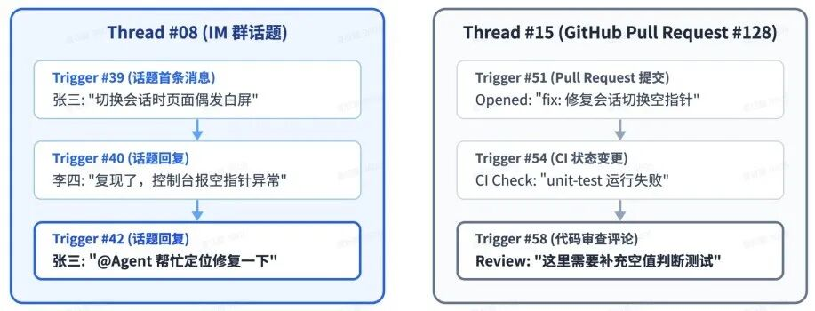
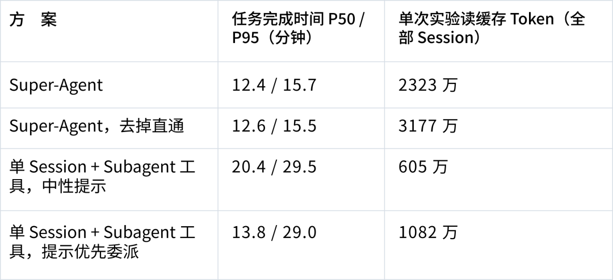

# Super-agent 实验与证据范围

2026-11-01。主文：[PR 合并以后，谁接下一条反馈？](../superagent.html)。

## 作者调度实验

来源为 [原文](https://mp.weixin.qq.com/s/zoS7GlReWPhfCjENGxXCdg) 第 7.1 节结果表，人工逐项转录。每种方案 5 次，约 300 条消息、20 条工作请求；编码使用仅消耗时间的模拟工具。消息间隔与工作时间缩为四分之一，模型时间保持真实值。

| 方案 | p50 分钟 | p95 分钟 | 缓存读取百万 token |
| --- | ---: | ---: | ---: |
| 中性提示单会话 | 20.4 | 29.5 | 6.05 |
| 优先委派单会话 | 13.8 | 29.0 | 10.82 |
| Super-agent | 12.4 | 15.7 | 23.23 |
| Super-agent 去直通 | 12.6 | 15.5 | 31.77 |

复算：`(29.0−15.7)/29.0=45.9%`，`(13.8−12.4)/13.8=10.1%`，`23.23/10.82=2.15`。去掉直通增加 `31.77/23.23−1=36.8%`；从没有直通启用直通降低 `1−23.23/31.77=26.9%`。两个百分比的分母不同。

不能推出真实代码质量、总账单或人工收益。缺少强制委派且同等过滤的强基线，无法独立归因于双层。原始 workload、逐任务日志与完整费用组成未公开。

第 7.2 节正文端点：batch 1→2.8，请求 2.5→3.9 秒，单个决定分摊推理时间 6.4→1.6 秒。后者与 T/B 不一致，完整定义与聚合口径不足，保留疑问，不据此外推稳定吞吐。

## 本次补充微实验

两模型共 110 次真实 CLI 调用、2348 个保存标签：easy 70 次/1248 标签，hard 40 次/1100 标签。CLI 0.213.1；模型名 DeepSeek-V4-Flash、Seed-2.1-Turbo，服务端权重版本未锁定。没有运行作者的常驻 Router/Worker 系统。

hard 每模型批量与重复次数：1/4/16/32/64/128 条，对应 6/4/3/3/2/2 次。耗时为 CLI turn.started 到 turn.completed 的墙钟时间，不是纯模型 API 推理耗时。完整汇总见 [公开数据](superagent-data.json)。

历史结果核对了保存标签、ID、类别、prompt 长度和重建输入；原始响应与完整事件轨迹未留存，无法审计输出顺序、重复 ID 或实际底层调用次数。不得将标签全部匹配称作生产正确率、严格输出契约通过或安全测试。

历史 JSONL 内容摘要：

- easy SHA256：`4af09d34711848f38187ef218f6c475b031de1ad4613e67f2057f06a3904a926`
- hard SHA256：`66932a0e54cad85d8d3874a7a20c5f6d494bcd5e1308d0b0c4905c7f54ac8b8b`

汇总数据可复算表中分摊耗时；摘要只能识别记录，不能补回缺失的原始响应。本次博客整理未新增模型实验。

## 原型工程与源码

公开原型固定在 `6337fc823ce20251c8de8085948165c81aaa701e`。先前本地 Node 22.19.0 验证 typecheck、1197/1197 测试及 build 通过；不等于真实飞书/GitHub 执行或作者 benchmark 已复现。本次文字和图表修订没有重跑原型工程测试。

本文的软件架构来自该固定源码和作者原文；原文插图沿用原图号，本次源码解读图单独标注。未将私人机器用量、公司规模或假设 ROI 当成已观察收益。

## 原图与正文的对应关系

正文图 3、4、5、7、8、10、11 根据原文按博客风格重绘，保留节点、连接与原图对照；[重绘索引](../assets/superagent/redrawn/sources.json)列出各图资源。实验原图 12、14 继续放在正文。归档原图字节与 2026-10-31 研究存档一致；[来源与文件摘要](../assets/superagent/original/sources.json)可核对。图中的 [2]～[6] 对应原文章节，不对应本文的新编号。

| 原文图 | 主题 | 当前位置 |
| --- | --- | --- |
| 3 | 总体架构与 Watchdog | 主文第 04 节 |
| 4、5、7 | 双层、过滤、订阅直通 | 主文第 01 节 |
| 8 | 链式召回 | 主文第 02 节 |
| 10、11 | 异步执行、计算/状态/环境分离 | 主文第 04 节 |
| 12、14 | 累计完成曲线、批处理 | 主文第 05 节 |
| 6、13 | Thread 示例、原始结果表 | 本附录下方 |

<figure class="article-figure original-figure" id="original-figure-6">

<figcaption>原文图 6｜Thread 示例：IM 话题与 GitHub PR 中的连续事件。来源：DeepSeek Harness 团队原文；点击查看原尺寸。</figcaption>
</figure>

<figure class="article-figure original-figure" id="original-figure-13">

<figcaption>原文图 13｜作者调度结果表：任务完成时间与缓存读取用量。来源：DeepSeek Harness 团队原文；点击查看原尺寸。</figcaption>
</figure>

原文的整体图是作者设计说明；公开版具体能力以固定源码为依据。尤其是云端/端侧部署和语义 Watchdog，不能仅凭插图标为公开版已实现。本站暖白 SVG 与交互图展开公开原型的任务对象、投递和 Effects，不替代这些原文图。
