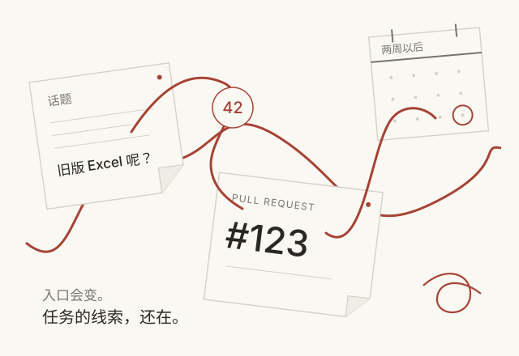
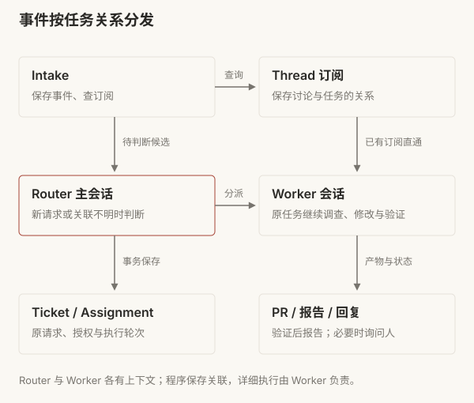
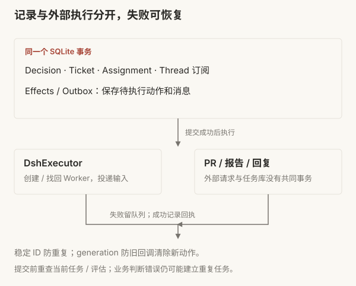
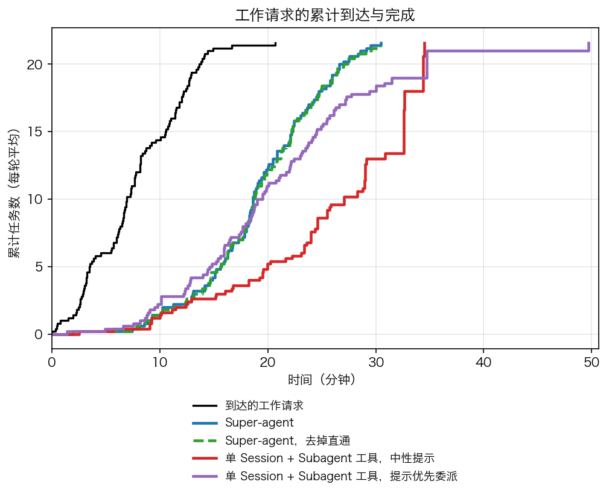
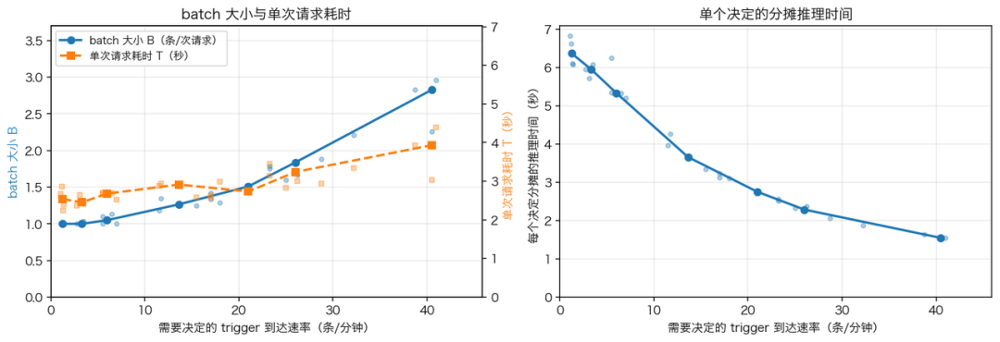

# PR 合并以后，谁接下一条反馈？

Super-agent 的任务分发与持续协作

假设你让 Agent 修复 CSV 导出的乱码。它提交 PR，评审通过，改动合并。两周后，同事在原话题里补充：“旧版 Excel 还是打不开。”

这时，需要继续的是同一件工作。系统得找到它的原始目标、旧讨论与代码，再根据现在的状态处理新反馈。如果每次都要人找回终端、复制消息、重新解释背景，会话管理就仍然是人的工作。

Super-agent 会把这次 CSV 修复记成一项任务，记录它来自哪个群聊、对应哪个 PR、目前处理到哪一步。PR 合并后，这条任务记录仍会保留。两周后同事在原话题里继续追问旧版 Excel 的问题，系统需要能找到之前的需求和修复记录，接着处理。

本文以这次假设的 CSV 修复为线索，结合 DeepSeek Harness（dsh）团队原文与公开原型 `6337fc8`。案例用来解释路径，不是一次真实修复的实测记录。公开版经过整理，与 dsh 内部实例及文章设计不完全一致；对应的实现范围会在相关机制旁说明。

<figure class="article-figure cover-figure"></figure>

## 五个观察点

要让系统接住这条反馈，dsh 的设计里有五个部分值得细看。每节先说 dsh 怎么做、公开原型做到哪里，再对照现有产品和框架的做法；现有方案的细节与来源见[调研笔记](superagent-landscape.md)。

| 观察点 | 在 CSV 例子里解决什么 | 公开原型 |
| --- | --- | --- |
| [Router](#routing) | 新消息属于哪项任务：同话题追问、另一话题引用旧 PR，还是新任务 | 已实现：程序准入、订阅直通、Router 判断 |
| [Session 数据库](#session) | 两周后找回原任务和原会话；进程退出时不丢待办动作 | 已实现：任务存 SQLite，会话交给 Harness 存 JSONL |
| [异步 ReAct Loop](#async) | Worker 跑长命令时，同事的补充不必等它跑完 | 借 Harness 实现：后台命令与输入投递 |
| [daemon](#daemon) | 云端的 Loop 在开发机上执行工具 | 未实现：只用本机子进程 |
| [Watchdog](#watchdog) | 发现 Worker 卡住、空转或偏离目标 | 只有部署文档里的每小时巡检配方 |

<figure class="article-figure original-figure wide-figure redrawn-figure" id="original-figure-3"><figcaption>图 3 · 整体设计（重绘）。<a href="https://mp.weixin.qq.com/s/zoS7GlReWPhfCjENGxXCdg">dsh 原文</a> · <a href="../assets/superagent/original/fig03.jpg">原图</a></figcaption></figure>

图中 [2]～[6] 是原文章节号。

## 01 Router：新消息归哪项任务

需求是在群聊里提出的，而代码在 PR 里评审，需求后续的问题还是得回到群聊中讨论解决。

dsh 把职责分成两层。Router 维持跨任务的高层关联和对外交互；每个 Worker 在独立上下文中调查、实现与验证。Worker 可以再用子 Agent 完成复杂任务，但对上层仍表现为一个执行者。

<figure class="article-figure original-figure compact-figure redrawn-figure" id="original-figure-4"><figcaption>图 4 · 双层分工（重绘）。<a href="https://mp.weixin.qq.com/s/zoS7GlReWPhfCjENGxXCdg">dsh 原文</a> · <a href="../assets/superagent/original/fig04.jpg">原图</a></figcaption></figure>

CSV Worker 负责“这次 CSV 乱码修复”，不是所有带 CSV 字样的需求。先弄清这个边界，再看新消息会走哪里。

<section class="route-demo" data-route-demo data-route="direct" aria-label="三条消息的路由示意">
又来了一条 CSV 消息，会交给谁？

<button type="button" data-route-case="followup" aria-pressed="true">同话题补充</button><button type="button" data-route-case="reference" aria-pressed="false">另一话题提 PR</button><button type="button" data-route-case="newtask" aria-pressed="false">提出新任务</button>

在原话题 A：“还要兼容旧版 Excel。”

<svg viewBox="0 0 700 207" role="img" aria-label="已绑定消息直达原Worker，新任务或关联不明由Router判断"><path class="route-line direct-line" d="M202 65 H490"/><path class="route-line router-line" d="M202 88 H240 V155 H280 M420 155 H462 V88 H490"/><rect class="node" x="12" y="29" width="190" height="84" rx="3"/><rect class="node" x="490" y="29" width="198" height="84" rx="3"/><rect class="node" x="280" y="125" width="140" height="60" rx="3"/><text x="29" y="58">新输入</text><text class="node-detail" x="29" y="88">所在话题与明确引用</text><text x="507" y="58" data-route-field="worker">原 Worker</text><text class="node-detail" x="507" y="88" data-route-field="ticket">Ticket-42</text><text x="316" y="159">Router</text><text class="route-label" x="276" y="52">已有订阅：程序直通</text><text class="route-label" x="21" y="173">新任务或关联不明：模型判断</text></svg>

同一任务，追加输入

程序查到话题 A 的订阅，直接加入 Ticket-42 的输入，原 Worker 在后续步骤接收补充。

依据公开源码的三种输入示意，未实时运行模型。跨话题的旧任务关联需要明确指向；意图不清时仍可能判断错误。

同时查看三条消息的处理

<table><thead><tr><th>新消息</th><th>路径与结果</th></tr></thead><tbody><tr><td>原话题 A：“还要兼容旧版 Excel”</td><td>程序查订阅，投递给 Ticket-42 的原 Worker。</td></tr><tr><td>话题 B：“PR #123 还要兼容旧版 Excel”</td><td>明确引用帮助 Router attach 旧任务，建立新讨论订阅。</td></tr><tr><td>话题 B：“增加 CSV 导入功能”</td><td>新任务；Router accept 新 Ticket 和 Worker。</td></tr></tbody></table>

<noscript>
上方展示第一条消息；展开表格可读全部三种路径。
</noscript></section>

同话题的补充由程序查订阅，直接加入原任务的输入队列。原型的 `Intake.receive()` 查 `Thread.subscriptions`，Executor 再通过 Harness 的 `agent.steer()` 把消息送进 Worker。正在运行的 Worker 在后续模型步骤接收补充，不需要先结束当前工作。

换一个话题时，“PR #123”这样的明确引用可以帮助 Router 找到原任务。它调用 `orchestrator_route` 选择 `accept / attach / stop / ignore`，宿主程序校验后执行。`attach` 建立新讨论与旧任务的关联，后续补充也能沿这条订阅找到执行者。

“增加 CSV 导入功能”是新任务，需要新建 Ticket 和 Worker。主题相似不足以复用旧任务。同一话题里也可能提出新任务：程序先按订阅送到原 Worker，Worker 发现超出本任务范围后用 `handback` 交回 Router。

<figure class="article-figure original-figure compact-figure redrawn-figure" id="original-figure-7"><figcaption>图 7 · 订阅与直通（重绘）。<a href="https://mp.weixin.qq.com/s/zoS7GlReWPhfCjENGxXCdg">dsh 原文</a> · <a href="../assets/superagent/original/fig07.jpg">原图</a></figcaption></figure>

订阅是多对多关系。一个任务可以关联群聊和 PR，一个讨论也可以被多个任务订阅。有人在原话题追问时，程序按订阅把消息直接送到 Worker，省去 Router 再次分派的开销。Router 仍会收到一条 `follow_up` 通知，说明消息已经送到哪些任务。它不再转发这条消息，但追问里可能有“先别做了”这样的要求，而停止任务由 Router 调用 `stop` 执行，所以它仍需要看到追问。读这条通知也要消耗推理成本。

### 消息先过准入，再判断归属

现实环境中，系统从群聊和 PR 收到的消息大多是闲聊、通知、背景资料等与任务无关的内容。dsh 的策略是先用程序规则过滤，再让模型判断剩下的消息。整体策略如下：

- **程序准入**：检查消息来自哪个来源和群组、是否在监听范围内、发送者是否在允许名单里、是否明确 @ 了 Agent。不符合规则的直接拦下，不调用模型。公开版对应来源配置和策略准入。
- **语义判断**：通过准入的消息成为候选，交给 Router。模型按提示词判断它是新任务、关联旧任务，还是普通讨论可以忽略。

程序过滤能减少模型调用；剩下的候选判断得准不准，还需要另外测试。

<figure class="article-figure original-figure wide-figure redrawn-figure" id="original-figure-5"><figcaption>图 5 · 两级过滤（重绘）。<a href="https://mp.weixin.qq.com/s/zoS7GlReWPhfCjENGxXCdg">dsh 原文</a> · <a href="../assets/superagent/original/fig05.jpg">原图</a></figcaption></figure>

### 谁写实施提示词

Router 转交原始请求和简短路由背景，不临时编写修复方案。Worker 使用共同角色模板，结合原请求、团队交付规则、工作目录和仓库 `AGENTS.md`，自己定位代码并选择方案。

> Router：新工作接单；明确指向旧任务才关联；主题相似不足以关联。转交原请求，不补实施计划。
>
> Worker：读取原始请求与仓库规范；处理原范围的补充；其他请求交回 Router。

Router 平时只看任务记录来分发，不读代码；查源码、定位问题是 Worker 的事。例外是系统主动发现的候选，也就是没人明确提出请求、但可能符合接单规则的消息。这时 Router 可以用限定范围的只读工具查看相关讨论和仓库，判断它是否在接单规则覆盖的范围内。公开版的 Router 仍然有 Bash 等工具，“不读代码、不亲自实现”主要靠提示词约束，工具层面并没有禁止。

### 重复任务与提前行动

两个人在不同讨论里描述同一个缺陷，产生两条 Trigger。Router 都当成新任务，就会有两个 Worker、两个 PR。消息 ID 去重只防重复投递，识别不了这种语义重复。公开版 `claimPull()` 只保证同一 PR 至多属于一个活跃 Ticket，不检查两个 PR 是否在修同一个问题。

dsh 内部实例还会在群聊讨论缺陷时，提前尝试复现并提交修复 PR，有价值再交付，没价值就放弃。公开原型可先在 `observe` 模式只记录本来会接的候选，再在 `auto` 模式按策略实际执行。原文只给了成功案例，没有给出全部尝试的数量。

### 现有方案怎么归属消息

| 方案 | 怎么判断新消息属于哪个任务 |
| --- | --- |
| Devin（Slack） | `@Devin` 发起会话，之后在同一 thread 里来回对话；`mute` 让它停止读取这个 thread |
| Cursor（Slack、GitHub） | thread 里已有 agent 时，再 `@Cursor` 算追加指令；`@Cursor agent` 强制新建 |
| Codex（Slack、GitHub） | 同一 thread、同一账号的后续请求延续原任务；PR 里 `@codex` 以这个 PR 为上下文 |
| GitHub Copilot cloud agent | PR 评论 `@copilot` 继续迭代，保留同一 PR 上之前会话的上下文 |

这些产品都按“同一 thread 或同一 PR 就是同一任务”归属消息。在它们的公开文档里，没有找到跨 thread、跨渠道的多对多订阅，也没有找到由模型判断“另一个话题提到的 PR #123 是不是旧任务”的做法。

## 02 Session 数据库：任务和会话存在哪里

两周后要接着修，系统得找回两样东西：这项任务的记录，和 Worker 当时的会话。公开原型把它们分开存：任务状态写进状态目录下的 SQLite 文件 `orchestrator.sqlite`，会话历史交给 DeepSeek Harness。

### 任务记录：四类记录

为了让“旧版 Excel 还是打不开”这条消息能定位到之前已有的同一项修复，系统需要用到四类不同的记录：

| 记录 | 在这次修复中是什么 |
| --- | --- |
| Trigger | 这条反馈的消息 ID、发送者、时间、原文和引用 |
| Thread | 原群聊话题或 PR 下的一段连续讨论，以及订阅它的任务 |
| Ticket | “修复 CSV 乱码”的目标、原请求、授权、输入与交付状态 |
| Assignment | 这项任务的一轮执行，包括启动、投递和报告 |

<figure class="article-figure compact-figure"><figcaption>公开原型的记录与投递路径。</figcaption></figure>
<section class="architecture-explorer" aria-label="交互架构图"><h3>探索完整架构</h3>
拖动画布平移，使用底部按钮缩放；点击节点查看相邻关系。

交互图将在阅读到此处时自动加载。<a href="../assets/superagent/architecture-full.svg">查看完整静态图</a>

</section>

新任务会新建 Ticket 和 Worker。旧任务重新开始时，比如修复已经结束又有人追问，系统不新建 Ticket，只在原 Ticket 下新开一轮执行，即新的 Assignment。Worker 会话的 ID 由 Ticket ID 固定生成（`worker-<ticketId>`），所以接手的还是原来的 Worker。Ticket 记录这是哪项工作，Assignment 记录其中一轮执行。上一轮结束了，Ticket 还在，同一项工作就能接着做。

### 会话历史：Harness 的 JSONL 日志

Router 和 Worker 的对话不在 SQLite 里。Harness 给每个会话写一份只追加的事件日志，文件名 `session.v3.jsonl.zstd`，默认用 zstd 压缩；同一时间只允许一个进程写入（`flock`）。上下文压缩只把旧条目从模型当前看到的视图里隐藏，原文不删。进程中断后恢复，Harness 会给没跑完的回合补写错误结果和结束标记。原型读取 Worker 记录时，按固定 ID `worker-<ticketId>` 找到对应会话。

<aside class="margin-note"><h3>日志放在哪个目录</h3>
任务库 <code>orchestrator.sqlite</code> 在部署配置的 <code>stateDir</code> 下；会话日志的根目录由 Harness 的 <code>dshHomePath('sessions')</code> 给出，每个会话一份文件。
</aside>

### 主会话不必一直装着全部历史

dsh 把有限的模型窗口看作缓存。近期很可能用到的摘要和引用直接放进窗口，即 **Inline**；完整、低频或太长的内容留在窗口外，按需读取，即 **Spill**。

当前反馈可以带原任务摘要和读取入口，Router 再沿引用展开：

`反馈 → 所在讨论 → 相关任务 → 最近报告 / 另一个已绑定 PR`

<figure class="article-figure original-figure wide-figure redrawn-figure" id="original-figure-8"><figcaption>图 8 · Inline & Spill（重绘）。<a href="https://mp.weixin.qq.com/s/zoS7GlReWPhfCjENGxXCdg">dsh 原文</a> · <a href="../assets/superagent/original/fig08.jpg">原图</a></figcaption></figure>

原文称它为链式召回：每次读到的对象带下一跳摘要与 ID。公开原型的候选卡片提供相关 Ticket 的标题、状态、最近报告预览和读取入口，完整任务、事件及订阅保存在 SQLite，执行记录由 Harness 保存。

<aside class="margin-note"><h3>窗口有上限，资料有入口</h3>
相关任务最多显示 8 个，同时给出总数。<code>orchestrator_read</code> 文本默认每页 4,000 字符，列表默认 20 项，并返回下一页入口。

主动讨论窗口也限制单条长度，必要时再读完整内容。
</aside>

Router preset 使用 Harness 的会话压缩与工具结果裁剪；提示词要求压缩后重新查看任务摘要。模型窗口的压缩不会删除数据库订阅，因此模型忘记了旧细节，已绑定讨论仍能按关系投递。

没有编号或引用的“几个月前那个导出问题”，仍要靠查找和判断，公开材料没有这方面的实验。

### 两周后怎么重新开始

原任务结束后，讨论订阅保留。人类在原话题或已合并 PR 下补充问题时，程序检查原授权有效、任务没有被人明确停止，然后新建执行记录，恢复原会话和目录。

恢复通知要求 Worker 检查**当前工作目录、Git 历史和 PR 状态**，只续办原范围的补充，超出范围交回 Router，避免重复已完成的动作。历史提供背景，现在的代码决定怎么继续。

会话还在时，只追加恢复通知和新输入；会话不存在时，才重新建立并提供原请求。输入按消息 ID 去重。被人明确停止的 Ticket 不会被普通后续消息自动恢复，机器人和 CI 也不会唤醒已结束的任务。

### 进程退出时，待办动作不能丢

再看一个假设的故障窗口：Router 决定接单，在群里回复了一句“收到，我来处理”，但 Worker 还没启动，进程就退出了。重启后，这句回复只留在聊天记录里，程序无从知道还有一个 Worker 等着启动。所以接单时，系统要把任务和“启动 Worker”这个待执行动作一起存下来，重启后才能接着做。

dsh 公开原型用三样东西解决这个问题：

- **状态目录锁**：同一份状态只允许一个进程打开，避免两个进程同时写。
- **SQLite 事务**：接单时，Decision、Ticket、Assignment、订阅、“启动 Worker”动作和群里的确认消息，在同一个事务里一起写入；任何一步失败就全部回滚，不会出现回复了“收到”却没有任务的情况。
- **持久 Effects 队列**：启动 Worker、发送消息这类对外动作，事务里只先记成队列项，提交后才真正执行。进程中途退出，重启后从队列里接着执行。

<figure class="article-figure compact-figure"><figcaption>数据库事务与外部动作。</figcaption></figure>

<aside class="margin-note"><h3>程序检查哪些旧状态</h3>
Trigger ID 防重复接单；Effects 的序号与 generation 防旧回调覆盖新动作。

每次工具调用用短事务读当前状态；投递前重查 Ticket 和 Assignment。
</aside>

这套办法管的是“本地还没写完就退出”。如果消息已经发到飞书或 GitHub，本地还没记下“已发送”就退出，重启后队列里这条动作仍是未完成，直接重试会再发一遍。SQLite 的事务管不到外部系统，只能靠固定消息 ID、回查会话历史或渠道来避免重复；Worker 的 Git 和 PR 操作也要在恢复时先核对实际状态。它也只管单个进程，不是多个 Router 副本之间的一致性协议。

### 现有方案存在哪里

| 方案 | 存在哪里 | 怎么恢复 |
| --- | --- | --- |
| Claude Code | 本机 `~/.claude/projects/<project>/<session>.jsonl`，默认保留 30 天 | `--resume`、`--fork-session`；Agent SDK 的 `SessionStore` 可镜像到共享存储，跨机器恢复 |
| Codex CLI | 本机 `~/.codex/sessions/YYYY/MM/DD/rollout-*.jsonl` | `codex resume`；以最近一条压缩记录为检查点重建 |
| OpenAI Conversations | OpenAI 服务端，持久保存消息与工具调用 | 按 ID 续接 |
| OpenHands SDK | 每个事件一个 JSON 文件（`events/event-*.json`） | 从持久化状态恢复会话 |
| Temporal、DBOS | 工作流事件历史，或 Postgres 中的步骤检查点；Workflow ID 唯一 | 重放时跳过已完成步骤；外部动作要求幂等 |

dsh 的会话日志和 Claude Code、Codex 同类，都是本机追加写 JSONL；现有方案多出来的是跨机器恢复和 fork。任务状态一侧，Temporal、DBOS 把“记下步骤结果、重放时跳过”做成了通用运行时，dsh 的 Effects 队列只管本地事务提交后的重试。

## 03 异步 ReAct Loop：跑长命令时还能接收补充

经典 ReAct Loop 等待工具完成再继续。dsh 改为先收到 Started 通知，工具后台运行，最终结果再作为事件进入会话；新输入在当前模型步骤结束后处理。

<figure class="article-figure original-figure wide-figure redrawn-figure" id="original-figure-10"><figcaption>图 10 · 同步与异步 ReAct Loop（重绘）。<a href="https://mp.weixin.qq.com/s/zoS7GlReWPhfCjENGxXCdg">dsh 原文</a> · <a href="../assets/superagent/original/fig10.jpg">原图</a></figcaption></figure>

公开原型借助 Harness 实现这一点：长命令放到后台运行，新消息通过输入投递送进会话。Router 会话的前台命令和等待任务结果最多阻塞 5 秒，超时就先返回，不会一直占着会话。所以用户不必等长命令跑完才补充要求；但模型正在生成的这一步不会被打断，新消息要等这一步结束后才被读到。

输出按渠道分工：IM 里只发简短结论和需要人决定的事；背景、改动内容和验证结果写在 PR 与文档里。原型限制每条 IM 回复最多 100 词，普通进度不发到群里，只有需要人处理的事才立即通知。人工时间是否因此减少，原文的实验没有测量。

| 方案 | 后台执行 | 运行中来了新消息 |
| --- | --- | --- |
| Claude Code | `run_in_background` 立即返回任务 ID；`Ctrl+B` 把运行中的命令转到后台 | 消息排队，当前工具调用结束后注入；`Esc` 中断 |
| Codex | `exec_command` 默认 10 秒后让出，之后轮询或写入 | `turn/steer` 插入进行中的回合，也可排队成下一条 |
| OpenAI Responses API | `background: true` 异步运行，轮询状态 | `response.steer` 中途追加指令（仅 GPT-6 系列经 WebSocket） |
| LangSmith Deployment | `interrupt()` 暂停，状态存入 checkpointer | 四种策略：enqueue、reject、interrupt、rollback；开源 LangGraph 没有 |

公开原型对运行中的新消息只有一种处理：送进当前会话，等下一步读入。现有方案把它做成了可选策略：排队、拒绝、中断或回滚。

## 04 daemon：Loop 在云端，工具在开发机

dsh 先把计算与持久状态分开，再把计算与执行环境分开：云端 Loop 访问独立数据库，通过轻量 daemon 在开发机或云端环境执行工具并取回结果。开发机上的未提交修改、内网依赖和工具链留在原地。

<figure class="article-figure original-figure wide-figure redrawn-figure" id="original-figure-11"><figcaption>图 11 · 计算、状态与执行环境分离（重绘）。<a href="https://mp.weixin.qq.com/s/zoS7GlReWPhfCjENGxXCdg">dsh 原文</a> · <a href="../assets/superagent/original/fig11.jpg">原图</a></figcaption></figure>

公开原型只用本机 SQLite、目录锁和本地子进程，没有实现图中的云端无状态容器与端侧 daemon。原文把安全、上下文边界与跨实例协作列为开放问题。

| 方案 | Loop 在哪 | 工具在哪执行 |
| --- | --- | --- |
| Cursor My Machines | Cursor 云端 | 用户机器；worker 向 Cursor 建立出站长连接，不开入站端口 |
| OpenHands | 后端 AgentController | 沙箱里的 `action_execution_server`，后端经 REST 下发动作；LocalRuntime 可在本机运行 |
| Claude Code self-hosted | 整个进程在用户主机 | 同一台主机；推理调用模型 API |
| GitHub Copilot cloud agent | GitHub | 云沙箱、GitHub Actions，或注册的自有机器 |

Cursor My Machines 和 OpenHands 已经是图 11 这种“Loop 在云端、工具在端侧”的形态。dsh 公开原型这一层还没有实现。

## 05 Watchdog：卡住、空转与跑偏

原文把 Watchdog 放在主系统之外，用定时消息驱动独立 Session，既处理接口与恢复故障，也判断 Worker 是否陷入无效循环或偏离目标。

公开部署文档有独立 profile 的每小时巡检配方：查状态，根据结果保持安静、报告故障或重启，并尊重人为停止标记。公开原型没有无效循环或跑偏检测的实现，也没有这方面的效果数据。

| 方案 | 检查什么 | 发现后 |
| --- | --- | --- |
| OpenHands StuckDetector | 五种重复模式，如同一动作得到同一结果 4 次、同一动作连续报错 3 次 | 先提醒模型一次，仍卡住就停止 |
| SWE-agent | 成本、调用次数、单条命令与总执行时间 | 超限退出；超成本时先提交再退出 |
| Temporal、Kubernetes | Activity 心跳与超时；liveness 探针 | 该次尝试失败并重试；重启容器 |
| LangGraph、Agents SDK、Claude Code | 步数上限、`max_turns`、guardrails、Stop hook | 抛异常或阻止结束；检查逻辑由用户自己写 |

卡住和空转已有机械化的判据，比如 OpenHands 的重复模式和 Temporal 的心跳。“偏离目标”在公开资料里没有找到现成实现，只有 guardrails、hook 这类由用户自己写的检查。

## 06 看改善，也看代价

dsh 先比较端到端调度，再测 Router 批处理。补充微实验则来自本次研究，三者的任务和指标不同。

<figure class="article-figure wide-figure tradeoff-figure"><figcaption>调度实验：耗时与缓存读取量。数据见 dsh 原文第 7.1 节。</figcaption></figure>

### 原文调度实验：慢端改善，缓存读取增加

原文第 7.1 节比较四种方案，每种运行 5 次。约 300 条消息中有约 20 条工作请求，编码被替换成只消耗时间的工具；消息间隔与工作时长缩为四分之一，模型耗时保持真实。测的是调度与协作，未测真实代码质量。

<figure class="article-figure original-figure " id="original-figure-12"><figcaption>原文图 12 · 工作请求的到达与完成。<a href="https://mp.weixin.qq.com/s/zoS7GlReWPhfCjENGxXCdg">dsh 原文</a></figcaption></figure>

| 方案 | p50 完成耗时 | p95 完成耗时 | 每次实验缓存读取 |
| --- | ---: | ---: | ---: |
| 单会话，中性提示 | 20.4 分钟 | 29.5 分钟 | 605 万 token |
| 单会话，优先委派 | 13.8 分钟 | 29.0 分钟 | 1,082 万 token |
| Super-agent | 12.4 分钟 | 15.7 分钟 | 2,323 万 token |
| Super-agent，去掉直通 | 12.6 分钟 | 15.5 分钟 | 3,177 万 token |

p50 是完成耗时中位数；p95 用来观察慢端。中性组 5 次都没有调用 Subagent，优先委派组 4 次委派、1 次自己执行，因此后者是更接近的对照。相较它，p50 改善约 10%，p95 改善约 46%，缓存读取为 2.15 倍。

去掉直通后，p50/p95 都只变化约 0.2 分钟且方向不同，缓存读取增加约 37%。这组负载支持直通节省协调开销，没有显示明显速度优势。

缓存读取包含所有 Session，但不是完整账单。只有 5 次运行，委派策略、过滤和架构也同时不同，不能将改善全归因于双层或当成稳定生产收益。完整价格、代码质量和人工时间仍需测量。

### 原文批处理实验：积压可以摊薄开销

原文第 7.2 节把需判断的 Trigger 从约 1 条/分钟提高到约 40 条/分钟。平均 batch 由 1 增至 2.8，单次请求从 2.5 秒增至 3.9 秒，单个决定分摊推理时间由 6.4 秒降至 1.6 秒。

<figure class="article-figure original-figure wide-figure" id="original-figure-14"><figcaption>原文图 14 · Router 批处理。<a href="https://mp.weixin.qq.com/s/zoS7GlReWPhfCjENGxXCdg">dsh 原文</a></figcaption></figure>

批量增长快于请求耗时，支持积压合并可以摊薄开销。但图中的分摊值不能直接由前两个端点相除得到，完整定义与聚合口径未充分公开，不能据此外推稳定容量。

### 补充微实验：每条更省，整批等得更久

本次研究另做 110 次 CLI 调用，观察固定批次的合成消息分类，并未复现 dsh 的常驻 Router。较复杂模板组的整轮墙钟耗时中位数：

| 模型 | 每批 1 条 | 每批 128 条 | 大批次每条分摊 |
| --- | ---: | ---: | ---: |
| DeepSeek-V4-Flash | 5.62 秒 | 65.17 秒 | 0.51 秒 |
| Seed-2.1-Turbo | 4.47 秒 | 75.36 秒 | 0.59 秒 |

每条消息平均用的时间少了，但要等到整批结果，还是得一分钟以上。这里的耗时也包括 CLI 和 Harness 运行所花的时间。

这次用的消息模板不多。每批 128 条的测试，每个模型只跑了两次，原始返回结果也没有保存下来，没法再逐条核对。所以，这组数据可以用来看批量处理后的耗时变化，实际用起来能不能把消息分对，还得另外测试。具体数据和测试记录见实验附录。

## 07 先让一件事能够续办

对研发团队，适合先选 CI 修复或评审跟进等边界清楚的范围：把请求、Worker、PR 和验收关联，自动续办已知任务，需要人决定时提供问题、进展与证据。

Super-agent 值得学习的，是把任务的持续身份与讨论关联写进系统。几周后再回到这件工作，系统应能说明做到哪里、依据什么、还需要人决定什么。长期模糊召回、重复任务协调和真实交付收益，仍需要继续验证。

## 来源与延伸阅读

- [DeepSeek Harness 团队原文](https://mp.weixin.qq.com/s/zoS7GlReWPhfCjENGxXCdg)：dsh 的整体设计、内部实例与两组初步实验。
- [公开原型固定版本](https://github.com/deepseek-ai/dsh-superagent-prototype/tree/6337fc823ce20251c8de8085948165c81aaa701e)：`prompts/dispatch.md`、`prompts/work.md`、`src/core/intake.ts`、`src/executor/dsh.ts`、`src/app/resources.ts`、`src/app/store.ts`、`src/app/effects.ts`。
- [原型架构文档](https://github.com/deepseek-ai/dsh-superagent-prototype/blob/6337fc823ce20251c8de8085948165c81aaa701e/docs/007-architecture.md)与[部署文档](https://github.com/deepseek-ai/dsh-superagent-prototype/blob/6337fc823ce20251c8de8085948165c81aaa701e/docs/006-deployment.md)：工具、状态、恢复与巡检。
- [五个观察点的现有方案调研](superagent-landscape.md)：Router、daemon、Watchdog、Session 存储与异步 Loop 的对照与来源。
- [实验附录与原图索引](superagent-evidence.md)、[架构图工具比较](architecture-tool-selection.md)、[botmux 配套文章](../superagent-botmux.html)。

架构图按 dsh 原文重绘，图号沿用原文；实验图保留原图。源码解读与路由示意依据公开原型，不代表实时运行结果。
